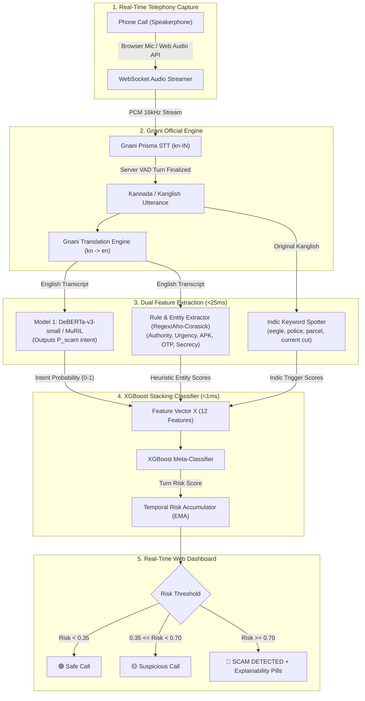
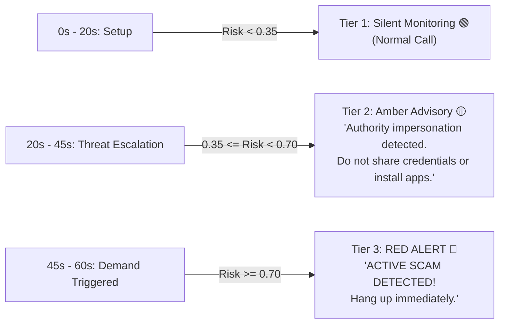

# Streamlined Architecture: Gnani ASR + DeBERTa/MuRIL + XGBoost Ensemble
## Gnani Hackathon Implementation Guide

---

## 1. Updated System Flow (Gnani ASR/Translation + Custom Ensemble)



---

## 2. Model Selection: Which Model for Intent Classification?

### Option 1 (Recommended): `microsoft/deberta-v3-small` (44M params)
* **Input:** English text from Gnani Translation Engine.
* **Why:** 
  * State-of-the-art token representations using disentangled attention.
  * Extremely compact (44 Million parameters vs 110M for BERT-base).
  * Inference latency: **8 to 14 ms** on CPU/Mac.
  * Easily fine-tuned for binary/multi-class intent classification.

### Option 2 (Few-Shot Speed Champion): `SetFit` with `sentence-transformers/all-MiniLM-L6-v2`
* **Input:** English text from Gnani Translation.
* **Why:**
  * Uses contrastive fine-tuning followed by a linear classification head.
  * Achieves 90%+ accuracy with as few as **50 to 100 labeled examples per category**.
  * Trains in **under 2 minutes** on Colab or Mac!
  * Inference latency: **< 6 ms**.

### Option 3 (Indic-Native Alternative): `google/muril-base-cased`
* **Input:** Raw Kannada / Kanglish directly from Gnani STT (bypasses translation).
* **Why:** Pre-trained on 17 Indian languages and Romanized scripts. Eliminates translation latency entirely.

---

## 3. Should You Use Ensemble Learning Like XGBoost?

### **YES, 100%. Here is why this architecture wins:**

A standalone transformer produces a single probability score, which creates two fatal hackathon flaws:
1. **Black-box decisions:** If an alert pops up, judges want to see *why*.
2. **False alarms on partial speech:** A customer saying *"Wait, my bank sent an OTP for my shopping"* might trick a transformer.

### The Stacking Architecture (Deep Learning + Heuristics $\to$ XGBoost)
Pass a 12-dimensional engineered feature vector $X$ into an **XGBoost classifier**:

| Feature Name | Type | Description |
| :--- | :--- | :--- |
| `intent_prob` | Float (0.0–1.0) | Prediction output from DeBERTa / SetFit. |
| `authority_impersonation` | Float (0.0–1.0) | Regex match for *CBI, Mumbai Police, Customs, Telecom Dept, TRAI, RBI, Judge*. |
| `urgency_coercion` | Float (0.0–1.0) | Keywords: *immediately, arrest warrant, within 30 mins, line disconnect, eegle*. |
| `credential_solicitation` | Binary (0/1) | Direct mention of *OTP, PIN, CVV, Card number, Password*. |
| `screen_sharing_apk` | Binary (0/1) | Specific tools: *AnyDesk, TeamViewer, QuickSupport, RustDesk, APK download*. |
| `financial_demand` | Float (0.0–1.0) | Demands to *transfer money, verification penalty, security deposit, bail*. |
| `secrecy_isolation` | Binary (0/1) | Directives like *don't tell anyone, stay in a closed room, don't disconnect*. |
| `turn_index` | Integer | Turn position in dialogue (scam escalation typically happens at turn $\ge 3$). |
| `word_count` | Integer | Length of the current turn (scammers give long scripted monologues). |
| `scam_momentum_ema` | Float (0.0–1.0) | Exponential Moving Average of previous turn risk scores. |

**Inference Time of XGBoost:** **$< 0.2\text{ ms}$**!  
**Demo Benefit:** You can display real-time SHAP feature importance pills in your UI:  
*(🚨 Triggered by: Authority Impersonation (92%) + Remote Software Demand (88%) + Urgency (75%))*

---

## 4. Compute Needed & Training Time Analysis

### 4.1 On Google Colab (Free T4 GPU - 16 GB VRAM)

| Model Component | Dataset Size | VRAM Usage | Training Time | Recommended Settings |
| :--- | :--- | :--- | :--- | :--- |
| **`SetFit` (MiniLM-L6-v2)** | 1,000–3,000 samples | ~1.5 GB | **1.5 to 2.5 minutes** | Batch size 16, 1 epoch contrastive, 1 epoch head |
| **`deberta-v3-small`** | 5,000 samples | ~3.2 GB | **5 to 8 minutes** | Batch size 32, FP16 enabled, 3 epochs |
| **`muril-base-cased`** | 5,000 samples | ~4.5 GB | **8 to 12 minutes** | Batch size 16, FP16 enabled, 3 epochs |
| **XGBoost Classifier** | 10,000 feature rows | Negligible (RAM) | **< 20 seconds** | `n_estimators=150`, `max_depth=4`, `learning_rate=0.08` |

### 4.2 On Apple Silicon Mac (M-Series / M1, M2, M3, M4, M5)

PyTorch uses the **Metal Performance Shaders (`mps`)** backend on Apple Silicon:

| Model Component | Dataset Size | Unified Memory | Training Time (MPS) | Notes |
| :--- | :--- | :--- | :--- | :--- |
| **`SetFit` (MiniLM-L6-v2)** | 1,000–3,000 samples | ~2 GB | **2 to 3 minutes** | Extremely fast; can even run on Mac CPU in ~4 min |
| **`deberta-v3-small`** | 5,000 samples | ~3.8 GB | **7 to 11 minutes** | Use `device="mps"`, batch size 16 |
| **`muril-base-cased`** | 5,000 samples | ~5.2 GB | **12 to 18 minutes** | Batch size 16, PyTorch MPS |
| **XGBoost Classifier** | 10,000 feature rows | Negligible | **< 15 seconds** | Runs natively multithreaded across all Mac performance cores |

---

## 5. Datasets Used & Synthetic Augmented Corpus

To train both the intent classifier and XGBoost ensemble, you will use a curated 3-part dataset pipeline:

### 5.1 Public Base Datasets
1. **`chinna887/Indian_Cyber_Scam_PhoneCall_Hinglish_Dataset` (Hugging Face)**:
   - ~10,000 conversational records of Indian cyber scams (Digital Arrest, Police/Customs Impersonation, FedEx parcel drug fraud, KYC updates, and OTP theft).
   - Format: Turn-by-turn text dialogues in Hinglish and English.
2. **`anmolshrivastav/scam-ham-india` (Hugging Face)**:
   - Indian scam and ham messages (UPI fraud, electricity bill disconnection, telecom prize scams).
3. **Kaggle: Scam and Non-Scam Call Conversation Dataset**:
   - Legitimate telemarketing calls, bank customer service calls, and scam calls.

### 5.2 Synthetic Kanglish Multi-Turn Generation
Because scammers targeting Karnataka speak Kannada mixed with English loanwords (*"Sir nimma Aadhaar card block aagide, Mumbai police station inda call maadtidivi"*), generate 2,500 Kanglish dialogues across 5 scam archetypes using few-shot prompting with an LLM:
- **Archetype 1:** Digital Arrest / Mumbai Police / CBI drug parcel scam.
- **Archetype 2:** BESCOM electricity bill disconnection scam.
- **Archetype 3:** Bank credit card reward points / KYC expiration scam.
- **Archetype 4:** APK installation / AnyDesk remote screen share scam.
- **Archetype 5 (Negative / Ham Class):** Swiggy/Zomato delivery, genuine bank customer support, casual family conversations.

### 5.3 Prefix-Augmentation (Crucial for Real-Time / Incomplete Data)
Scammers don't start with "I am a scammer". Early turns contain incomplete information.  
**To make the model robust to incomplete turns, use Prefix Slicing during training:**
For every 6-turn scam conversation, create progressive training instances:
- Instance A: Turn 1 only (Label: Ambiguous / Low scam prob).
- Instance B: Turns 1 + 2 (Label: Rising Suspicion / Medium prob).
- Instance C: Turns 1 + 2 + 3 (Label: Definite Scam / High prob).

This forces the classifier to recognize early red flags (unsolicited authority claims, artificial urgency) even when the final demand hasn't been spoken yet.

---

## 6. Step-by-Step Training Methodology

### Step 1: Train the Intent Classifier (`deberta-v3-small` or `SetFit`)
* **Framework:** Hugging Face `transformers` + `Trainer` (or `setfit`).
* **Input:** English translated text (or transliterated Kanglish if using MuRIL).
* **Objective:** Binary cross-entropy loss (Scam vs. Genuine) or 4-class multi-label (Impersonation, Coercion, Exploitation, Safe).
* **Hyperparameters:**
  * Base model: `microsoft/deberta-v3-small`
  * Learning rate: `3e-5` with linear warmup (10% steps) and weight decay `0.01`
  * Batch size: 32 (Colab T4) or 16 (Mac MPS)
  * Epochs: 3
  * Mixed precision: `fp16=True` (Colab) or native MPS float32/fp16 (Mac)
* **Training Time:** **5 to 8 minutes** on Colab T4.

### Step 2: Generate Out-of-Fold (OOF) Predictions
To train the XGBoost meta-learner without data leakage:
* Run 5-fold cross-validation on the training set using the intent classifier.
* Record the predicted probability $P_{\text{scam}}$ for each turn.

### Step 3: Extract Heuristic Feature Matrix
For every training dialogue turn, run the fast regex/keyword spotter to extract the 11 engineered features:
* `authority_score`, `urgency_score`, `credential_solicitation`, `remote_access_apk`, `financial_demand`, `isolation_directive`, `turn_index`, etc.

### Step 4: Train the XGBoost Ensemble
* **Framework:** `xgboost.XGBClassifier`
* **Input:** 12 features ($P_{\text{scam}}$ from DeBERTa + 11 heuristic features).
* **Hyperparameters:**
  ```python
  xgb_model = xgb.XGBClassifier(
      n_estimators=150,
      max_depth=4,
      learning_rate=0.08,
      subsample=0.85,
      colsample_bytree=0.85,
      scale_pos_weight=1.2, # slight penalty on missed scams
      eval_metric="auc"
  )
  ```
* **Training Time:** **< 20 seconds** on CPU.

---

## 7. Handling Real-Time Streaming & The "Incomplete Info" Problem

### 7.1 Why Real-Time Has Incomplete Info
In streaming, you never have the full conversation upfront. A scam unfolds across an emotional trajectory:
1. **Turns 1–2 (0–20s): Setup & Hook** (*"Hello, this is Inspector Patil from Mumbai Cyber Crime"*).
2. **Turns 3–4 (20–45s): Threat & Secrecy** (*"Your Aadhaar was found in an illegal parcel with drugs, an arrest warrant is active. Go to a quiet room and don't hang up"*).
3. **Turns 5–6 (45–75s): The Squeeze / Exploitation** (*"To cancel the warrant, install this verification app or send security deposit"*).

### 7.2 Is a 1-Minute Decision Time Target Right?
**YES, a 45-to-60 second target is the exact industry "Golden Window".**
- If you alert at **10 seconds**, you get false alarms on legitimate calls.
- If you wait until **2 to 3 minutes**, the victim has already panicked, downloaded AnyDesk, or shared an OTP!
- **Targeting ~45–60 seconds intercepts the scammer right at the pivot between threat and exploitation.**

---

### 7.3 Multi-Tier Progressive Threat Horizon

Instead of a single binary decision, implement a **3-Tier Progressive Alert Horizon**:



1. **Tier 1 (0–20s) - Silent Monitoring (Green 🟢):**
   - The engine logs entities and calculates baseline intent. No alert shown.
2. **Tier 2 (20–45s) - Amber Pre-Emptive Advisory (Yellow 🟡):**
   - Triggered when Authority + Urgency scores rise ($0.35 \le \text{Risk} < 0.70$).
   - Banner warning: *"Caller claims to be Police / Govt with urgent threats. Stay calm. Do not share screen or OTP."*
   - This prepares the victim psychologically before the scammer makes the financial demand.
3. **Tier 3 (45–60s) - Critical Scam Intercept (Red 🔴):**
   - Triggered when Exploitation or Screen Sharing demand appears ($\text{Risk} \ge 0.70$).
   - Flashes loud red modal with vibration: *"CRITICAL FRAUD ALERT: Scammer requesting remote access / money. HANG UP IMMEDIATELY!"*

---

### 7.4 Real-Time Streaming Mechanics (How to Prevent Flicker)

1. **Turn-Level Chunking via Gnani VAD:**
   - Never classify raw partial phonemes mid-word.
   - Rely on Gnani's WebSocket `is_final: true` event (triggered when speech pauses $\ge 350\text{ms}$).
2. **Sliding Context Window:**
   - Maintain a FIFO buffer of the last 3 turns:
     $$\text{Context}_t = [\text{Turn}_{t-2}, \text{Turn}_{t-1}, \text{Turn}_t]$$
   - This provides the intent model with conversational flow rather than isolated sentences.
3. **Exponential Moving Average (EMA) Risk Smoothing:**
   - Prevent a single misunderstood phrase from triggering a false alarm:
     $$\text{Risk}_t = \alpha \cdot \text{Risk}_{t-1} + (1 - \alpha) \cdot S_{\text{turn}}$$
   - With $\alpha = 0.6$, the risk score rises rapidly when sustained hostile turns occur, but resists single-turn spikes.

---

## 8. Summary Hackathon Checklist

1. **Ingestion:** Stream audio via Web Audio API $\to$ Gnani Prisma STT (`kn-IN`) $\to$ Gnani Translation (`kn -> en`).
2. **Classifier:** Train `microsoft/deberta-v3-small` (or `SetFit`) on prefix-augmented scam dialogues (Colab T4 in 6 mins).
3. **Ensemble:** Combine intent probabilities with 11 regex/keyword indicators in **XGBoost** (trains in 20s, infers in 0.2ms).
4. **Real-time UX:** 1-minute target window with a **3-Tier Progressive Alert** (Green $\to$ Yellow $\to$ Red) and live explainability pills.
